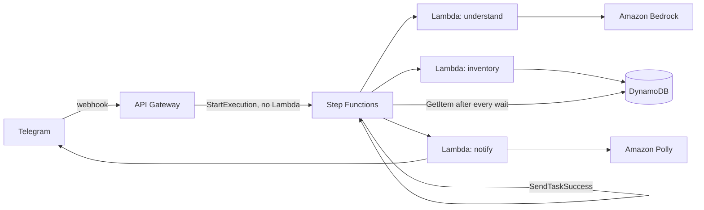

# Tupper Guardian

A Telegram bot that remembers what you put in the fridge and warns you before
it goes bad. Built for older adults: no app to install, no forms. Send a text
or a photo, and the bot does the rest. If an expired item goes unattended, a
family member gets a heads-up.

100% serverless on AWS. No servers, no pipeline: one script deploys everything.

## How it works



1. **API Gateway starts the workflow directly.** Telegram gets its `200`
   immediately, and the execution is named after Telegram's `update_id`, so a
   redelivered update can never be processed twice. No code involved.
2. **Bedrock understands; data decides.** The model only extracts
   `{intent, food, category}` from text or a photo. The category is validated
   against a closed list and the shelf life comes from a DynamoDB table of
   conservative values. The model never decides how long food is safe.
3. **Step Functions waits for free.** Each stored item keeps one execution
   paused until the day before it expires, then until it expires. After every
   wait it re-reads DynamoDB, so an item you already ate triggers nothing.
4. **Human in the loop.** At expiry the bot asks what happened, with three
   buttons, and the workflow pauses on a task token. A button press releases
   it. If nobody answers in time, the linked family member is notified.
5. **Voice.** Confirmations and alerts are also sent as a voice note (Polly).

| You send | The bot does |
|---|---|
| "Guardé caldo de pollo en el refri" or a photo | Registers it and schedules the alerts |
| "Ya me comí el caldo" | Closes it and adds to your rescued count |
| "¿Qué tengo en el refri?" | Lists what is still active |
| `/familiar` | Returns a link that registers a family member as caregiver |

## Deploy

Requirements: AWS CLI v2 with credentials, `python3`, a bot token from
[@BotFather](https://t.me/BotFather), and access to a Bedrock model that
accepts images (default `us.amazon.nova-lite-v1:0`).

```bash
./scripts/store_bot_token.sh   # once: saves the token as an SSM SecureString
./scripts/deploy.sh            # package, deploy, seed data, register webhook
```

Demo timings, where a "day" lasts 20 seconds:

```bash
SECONDS_PER_DAY=20 ASK_TIMEOUT_SECONDS=45 ./scripts/deploy.sh
```

Other settings (environment variables): `AWS_REGION`, `MODEL_ID`,
`STACK_NAME`, `VOICE_ENABLED`.

To remove everything: `aws cloudformation delete-stack --stack-name tupper-guardian`.

## Tests

```bash
python3 -m venv .venv && .venv/bin/pip install boto3 pytest "moto[dynamodb]"
.venv/bin/python -m pytest
```

## Layout

| Path | Purpose |
|---|---|
| `template.yaml` | All infrastructure (SAM transform) |
| `statemachine/guardian.asl.json` | The workflow (JSONata) |
| `src/guardian/understand.py` | Text or photo to intent, via Bedrock |
| `src/guardian/inventory.py` | All DynamoDB state changes |
| `src/guardian/notify.py` | Telegram messages, buttons, voice notes |
| `src/guardian/shelf_life.json` | Shelf-life data and the closed category list |

## Notes and limits

- Shelf-life values are conservative lower bounds of general USDA / FoodKeeper
  guidance. They are a reminder aid, not food-safety advice.
- The webhook is protected by an unguessable path segment and rate limiting.
- Telegram is the prototype channel. WhatsApp and voice-message input are the
  natural next steps.
