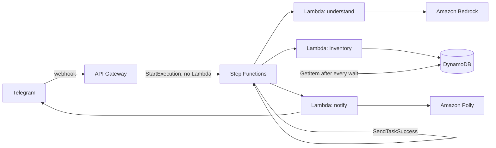

# Tupper Guardian

A Telegram bot that keeps track of what is in the family fridge and warns
before food goes bad. Built for older adults: no app to install, no forms.
Send a text or a photo, and the bot does the rest. A fridge can be shared by
invitation, so a family manages its contents and expiry dates together.

100% serverless on AWS. No servers, no pipeline: one script deploys everything.

## How it works



1. **API Gateway starts the workflow directly.** Telegram gets its `200`
   immediately, and the execution is named after Telegram's `update_id`, so a
   redelivered update can never be processed twice. No code involved.
2. **Bedrock understands; data decides.** The model only extracts
   `{intent, food, category}` from text or a photo. The category is validated
   against a closed list and the shelf life comes from a DynamoDB table of
   conservative values. The model never decides how long food is safe.
3. **Step Functions waits for free.** Each stored item keeps one execution
   paused until the day before it expires, then until it expires. After every
   wait it re-reads DynamoDB, so an item you already ate triggers nothing.
4. **Human in the loop.** At expiry the bot asks whoever stored the item what
   happened, with buttons, and the workflow pauses on a task token. A button
   press releases it. "Sigue ahí" postpones the question a day, twice at
   most: the third question is a last call without that button. Eating
   something a full day past its deadline gets a health message instead of
   a confirmation.
5. **One question at a time.** Each person has a single question turn, so
   items that expire together are asked about one by one instead of in a
   burst that gets lost in the chat.
6. **Nothing disappears by silence.** An unanswered item stays in the fridge
   flagged for review, and the other members of the fridge are told. With
   nobody else in the fridge, the bot explains what `/familiar` is for. The
   list shows expired items first and offers to review them one by one.
7. **Shared fridge.** `/familiar` returns a single-use link. Whoever opens it
   joins the fridge: same list, and any member can resolve any item.
8. **Voice.** Confirmations and alerts are also sent as a voice note (Polly).

| You send | The bot does |
|---|---|
| "Guardé caldo de pollo en el refri" or a photo | Registers it and schedules the alerts |
| "Ya me comí el caldo" / "Ya tiré el caldo" | Removes it from the fridge |
| "¿Qué tengo en el refri?" or `/refri` | Lists what is in the fridge, expired items first |
| `/familiar` | Returns a single-use link to share the fridge with a relative |

The full architecture guide, with diagrams of the item lifecycle and the
human-in-the-loop flow, is in [`docs/architecture.html`](docs/architecture.html).
Open it in a browser.

## Deploy

Requirements: AWS CLI v2 with credentials, `python3`, a bot token from
[@BotFather](https://t.me/BotFather), and access to a Bedrock model that
accepts images (default `us.amazon.nova-lite-v1:0`).

```bash
./scripts/store_bot_token.sh   # once: saves the token as an SSM SecureString
./scripts/deploy.sh            # package, deploy, seed data, register webhook
```

Demo timings, where a "day" lasts 20 seconds:

```bash
SECONDS_PER_DAY=20 ASK_TIMEOUT_SECONDS=45 ./scripts/deploy.sh
```

Other settings (environment variables): `AWS_REGION`, `MODEL_ID`,
`STACK_NAME`, `VOICE_ENABLED`.

To remove everything: `aws cloudformation delete-stack --stack-name tupper-guardian`.

## Tests

```bash
python3 -m venv .venv && .venv/bin/pip install -r requirements-dev.txt
.venv/bin/python -m pytest
```

The suite needs no AWS account or network: DynamoDB and SSM are mocked with
moto, and Bedrock, Polly and Telegram are replaced by fakes.

| File | What it pins |
|---|---|
| `tests/test_inventory.py` | Shelf life, alert scheduling, closing items, buttons, caregiver linking |
| `tests/test_understand.py` | Intent extraction and validation of the model output |
| `tests/test_notify.py` | Message catalog, buttons, task-token ordering, voice notes |
| `tests/test_telegram.py` | Bot API requests, errors that never leak the token, voice upload |
| `tests/test_workflow_definition.py` | State machine structure and its match with the template |

## Try it

After deploying in demo mode (a "day" lasts 20 seconds):

1. Send `Guardé caldo de pollo en el refri`. The bot confirms with text and a
   voice note. About 40 seconds later it reminds you that it expires tomorrow.
2. At expiry it asks what happened. Tap **Sigue ahí** twice: each time it asks
   again a "day" later.
3. The third question is the last call, with only **Ya me lo comí** and
   **Ya lo tiré**. Answer it, or wait 45 seconds: the item stays in the fridge
   flagged for review, and the bot invites you to share the fridge.
4. Store three items in a row and let them expire: the questions arrive one
   at a time, each saying how many more are waiting.
5. Send `/refri`, tap **Revisar vencidos** and answer the flagged items one by
   one.
6. Send `/familiar`, open the link from a second Telegram account, and send
   `/refri` from it: both accounts see the same fridge. Let a question go
   unanswered: the second account gets the heads-up and can resolve it.

## Troubleshooting

- **`AccessDenied` with "explicit deny in a service control policy"**: the
  account only allows some regions. Export the allowed one in the same shell
  that runs the scripts, for example
  `export AWS_REGION=us-east-2 AWS_DEFAULT_REGION=us-east-2`. Without it,
  `deploy.sh` uses the AWS CLI default region, then `us-east-1`.
- **`CERTIFICATE_VERIFY_FAILED` in `telegram_admin.py`**: the python.org
  build of Python for macOS ships without root certificates. Run
  `export SSL_CERT_FILE=/etc/ssl/cert.pem` in that shell, or run
  `Install Certificates.command` from the Python folder in Applications.
- **"Bedrock model ... is not usable"**: list the inference profiles of the
  region and rerun with `MODEL_ID=<id>`. The model must accept images.
- **The bot does not answer**: `python3 scripts/telegram_admin.py info` shows
  the webhook status and Telegram's last delivery error. Then check the
  latest executions of the state machine in the Step Functions console.

## Layout

| Path | Purpose |
|---|---|
| `template.yaml` | All infrastructure (SAM transform) |
| `statemachine/guardian.asl.json` | The workflow (JSONata) |
| `src/guardian/understand.py` | Text or photo to intent, via Bedrock |
| `src/guardian/inventory.py` | All DynamoDB state changes |
| `src/guardian/notify.py` | Telegram messages, buttons, voice notes |
| `src/guardian/messages.py` | Every user-facing message (Spanish) |
| `src/guardian/telegram.py` | Minimal Bot API client (standard library) |
| `src/guardian/shelf_life.json` | Shelf-life data and the closed category list |
| `scripts/` | Deploy, token storage, seeding, webhook administration |
| `tests/` | Unit tests (see above) |
| `odd/tasks/tupper-guardian.md` | Specs, task status and decision log |

## Notes and limits

- Shelf-life values are conservative lower bounds of general USDA / FoodKeeper
  guidance. They are a reminder aid, not food-safety advice.
- The webhook is protected by an unguessable path segment and rate limiting.
- A person belongs to one fridge at a time. Joining another one is refused
  while it would leave food in a fridge nobody else shares.
- Telegram is the prototype channel. WhatsApp and voice-message input are the
  natural next steps.

## Roadmap

- **Shopping list import (must-have).** Send the shopping list and have every
  product stored with an expiry date recommended by a third-party source.
